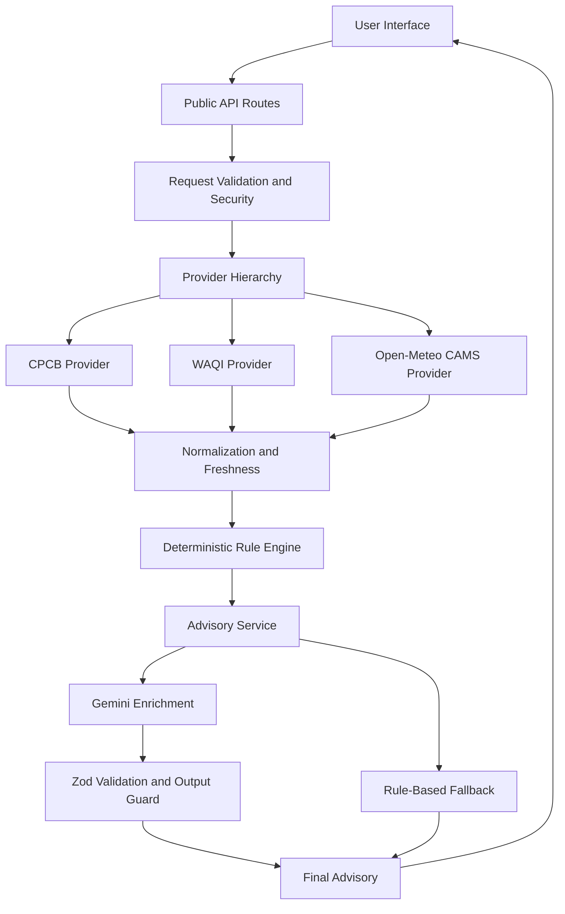

# 🌿 VayuSetu — Urban Air Quality & Winter Smog Assistant

<p align="center">
  <strong>Bridging the gap between environmental data and healthier everyday decisions.</strong>
</p>

<p align="center">
  <a href="https://vayusetu-eight.vercel.app">
    
  </a>
  
  
  
  
</p>

<p align="center">
  <a href="https://vayusetu-eight.vercel.app">🚀 Explore the Live Application</a>
  &nbsp; • &nbsp;
  <a href="https://github.com/AbdulWebAgency/VayuSetu">💻 Source Code</a>
</p>

**VayuSetu** is an AI-assisted urban air-quality companion designed to help Indian households make safer, more informed and sustainable everyday decisions during periods of air pollution and winter smog.

It combines environmental data from air-quality providers with deterministic safety rules and optional Google Gemini enrichment to deliver practical recommendations based on location, household circumstances and available air-quality information.

🌐 **Live application:** https://vayusetu-eight.vercel.app
💻 **GitHub repository:** https://github.com/AbdulWebAgency/VayuSetu

---

## 🎯 Problem statement

Air pollution affects everyday decisions: when to commute, whether to exercise outdoors, how to ventilate a home and what precautions different household members may need.

However, raw AQI readings alone do not always explain what people should actually do.

VayuSetu aims to bridge that gap by translating environmental information into understandable, practical guidance for Indian households.

## 🌱 Three core pillars

### 1. Low-emission daily routines

Practical recommendations for adjusting daily activities based on environmental conditions, including commuting, outdoor activities and household routines.

### 2. Indoor air-quality guidance

Guidance on ventilation, reducing indoor pollution sources and interpreting user-reported indoor PM2.5 readings.

### 3. Sustainable alternatives and impact

Suggestions for more sustainable everyday choices, including alternatives that can help reduce individual and household contributions to pollution.

Recommendations are designed to explain their reasoning rather than simply present instructions.

---

## ✨ Key features

- **Location-aware air-quality information:** Supports Indian locations and uses available environmental data providers.
- **Household personalisation:** Considers household circumstances and the needs of different members.
- **Daily planning:** Organises practical recommendations across morning, afternoon and evening.
- **Indoor air-quality guidance:** Provides actionable suggestions without treating a single indoor PM2.5 reading as a complete indoor AQI measurement.
- **AI-enriched recommendations:** Uses Google Gemini to improve the explanation and presentation of guidance when available.
- **Deterministic fallback:** Continues to provide rule-based guidance when AI services are unavailable.
- **Data provenance:** Displays relevant source, measurement timing and AQI scale information.
- **Safety checks:** Validates AI-generated responses before they are presented to users.

---

## 🧠 Data integrity and safety

Environmental information must be trustworthy. VayuSetu therefore separates environmental data retrieval from AI-generated explanations.

### Environmental data

The application uses a provider hierarchy involving:

- CPCB data through the data.gov.in API, where configured and available.
- WAQI ground-station data, where configured and available.
- Open-Meteo CAMS model data as an alternative source.

Provider availability can vary. The application preserves the provenance of the selected data rather than combining readings from different providers into a fabricated measurement.

### Freshness classification

Freshness is calculated using the provider's `measuredAt` timestamp, not the time the application fetched the data.

| Data type      |         Live |                     Aging |        Stale |
| -------------- | -----------: | ------------------------: | -----------: |
| Ground station |  ≤90 minutes |            91–180 minutes | >180 minutes |
| Model data     | ≤180 minutes | Not separately classified | >180 minutes |

Invalid measurement timestamps are treated as stale.

### Indoor air-quality safeguards

- Indoor PM2.5 values are user-reported.
- A single PM2.5 reading is not converted into an indoor AQI value.
- Indoor and outdoor readings are compared only when their measurement timestamps are sufficiently close (within 120 minutes).
- Qualitative indoor guidance remains available even when a meaningful numerical comparison cannot be made.

### AI is an enrichment layer, not the source of truth

Gemini does not generate live AQI measurements or replace environmental data providers.

Instead, it helps produce contextual explanations and recommendations using available information.

AI responses are validated using Zod schemas and additional output-guard checks. Unsupported environmental numerical claims and unsafe recommendations are subject to these safeguards.

If AI enrichment fails, the deterministic rule engine continues to provide guidance.

---

## 🏗️ Architecture

VayuSetu follows a separation-of-concerns architecture, keeping environmental data retrieval, domain logic, AI enrichment and presentation separate.



### Provider hierarchy

Environmental providers are handled through a dedicated provider hierarchy. The application normalizes incoming data into a common internal representation while retaining the original source and measurement metadata.

This avoids treating readings from different providers as interchangeable or silently merging incompatible measurements.

---

## 🧩 Project structure

The following are the principal application modules:

| Directory / File                | Responsibility                                                                  |
| ------------------------------- | ------------------------------------------------------------------------------- |
| `src/routes/`                   | Application pages and public API endpoints                                      |
| `src/components/dashboard/`     | Air-quality overview, household profile, daily planner and recommendations      |
| `src/components/common/`        | Shared components such as error boundaries and severity badges                  |
| `src/domain/`                   | Freshness, normalization, indoor comparisons, rule engine and output validation |
| `src/server/providers/`         | Environmental data providers, geocoding and provider hierarchy                  |
| `src/server/gemini/`            | Gemini client and prompt construction                                           |
| `src/server/security/`          | Request validation and rate-limiting logic                                      |
| `src/server/advisoryService.ts` | Advisory generation and AI fallback orchestration                               |
| `src/types/`                    | Shared TypeScript data types                                                    |
| `tests/`                        | Unit, integration, component, contract and security tests                       |

---

## 🔐 Security and reliability

Security and reliability are built into the server-side architecture.

- **Server-side secrets:** API keys are accessed through server-side environment variables and are not exposed through `VITE_` variables.
- **Request validation:** Public API requests are validated before processing.
- **Request-size protection:** Request bodies are subject to size limits.
- **Origin validation:** Same-origin requests are supported, with optional additional allowed origins.
- **Rate limiting:** Fixed-window, per-key rate limiting is implemented as a best-effort, per-instance mechanism.
- **AI response validation:** Gemini responses are checked against a Zod schema and output guardrails.
- **Provider resilience:** Provider failures and unavailable AI services are handled through fallback paths.
- **Timeout handling:** Gemini requests have per-attempt timeouts and retry handling for eligible failures.

**Rate-limiting limitation:** The current limiter stores its counters in memory. It is not a distributed rate limiter, so limits are not globally shared across serverless instances.

---

## 🤖 Gemini integration

Gemini is used to enrich contextual recommendations while preserving deterministic environmental data and safety rules.

The integration includes:

- Configurable model selection through `GEMINI_MODEL`.
- A default model of `gemini-3.5-flash-lite` in the current client implementation.
- Fallback model handling.
- Per-attempt timeouts and retries for eligible failures.
- Structured JSON response generation.
- Zod schema validation.
- Output guardrails.
- Deterministic rule-based fallback when AI enrichment is unavailable.

The application is designed to remain useful without a configured Gemini API key.

---

## 🧪 Testing and verification

The project includes automated tests covering the application’s domain logic, security boundaries, provider contracts, advisory pipeline and user-interface components.

### Latest verified test results

| Test category    |     Result |
| ---------------- | ---------: |
| Test files       |  16 passed |
| Individual tests | 111 passed |
| Failed tests     |          0 |

**Command executed:**

```bash
npm test
```

**Result:** All 16 test files and all 111 tests passed.

Additional verification previously completed:

- Production build completed successfully.
- Vercel deployment configuration was checked.
- The deployed application was verified at the production URL.

---

## 🚀 Deployment

VayuSetu is deployed on Vercel.

| Configuration             | Value           |
| ------------------------- | --------------- |
| Hosting                   | Vercel          |
| Runtime                   | Node.js 24.x    |
| Region                    | Mumbai (`bom1`) |
| Maximum function duration | 60 seconds      |
| Framework                 | TanStack Start  |
| Build tool                | Vite            |

The deployment configuration specifies Mumbai as the deployment region and a maximum function duration of 60 seconds.

---

## 💻 Run locally

### Prerequisites

- Node.js 24.x recommended
- npm
- A Google Gemini API key (optional)
- Optional provider API keys for additional environmental data sources

### 1. Clone the repository

```bash
git clone https://github.com/AbdulWebAgency/VayuSetu.git
cd VayuSetu
```

### 2. Install dependencies

```bash
npm install
```

### 3. Configure environment variables

Create a `.env` file in the project root.

```env
GEMINI_API_KEY=
GEMINI_MODEL=
WAQI_API_TOKEN=
DATA_GOV_IN_API_KEY=
ALLOWED_ORIGINS=
```

| Variable              | Purpose                                                     |
| --------------------- | ----------------------------------------------------------- |
| `GEMINI_API_KEY`      | Optional Google Gemini API key for AI-enriched guidance     |
| `GEMINI_MODEL`        | Optional Gemini model override                              |
| `WAQI_API_TOKEN`      | Optional WAQI ground-station data access                    |
| `DATA_GOV_IN_API_KEY` | Optional CPCB data access through data.gov.in               |
| `ALLOWED_ORIGINS`     | Optional comma-separated list of additional allowed origins |

All secrets must remain server-side. Do not prefix these variables with `VITE_`.

Without a Gemini API key, the application can still provide deterministic rule-based guidance.

### 4. Start the development server

```bash
npm run dev
```

### 5. Build for production

```bash
npm run build
```

### 6. Run automated tests

```bash
npm test
```

### Additional test commands

```bash
npm run test:watch
npm run test:e2e
npm run test:smoke
```

The smoke-test script uses Bun, so Bun must be installed to run it. Playwright browser installation may also be required before running the end-to-end tests.

---

## ⚖️ Limitations

VayuSetu is an informational and decision-support application, not a medical diagnostic system.

- Environmental data availability depends on external providers.
- Ground-station coverage and measurement frequency vary by location.
- Model-based estimates are not equivalent to direct ground-station measurements.
- Indoor measurements are user-reported and may not represent an entire home.
- AI-generated explanations are constrained by validation and safety rules, but should not replace official public-health guidance.
- Rate limiting is per serverless instance rather than globally distributed.

Users should follow official health advisories during severe pollution events.

---

## 🛠️ Technology stack

| Area               | Technologies                        |
| ------------------ | ----------------------------------- |
| Frontend           | React 19, TypeScript                |
| Framework          | TanStack Start, TanStack Router     |
| Styling            | Tailwind CSS                        |
| UI components      | Radix UI, Lucide React              |
| Data fetching      | TanStack Query                      |
| Validation         | Zod                                 |
| AI integration     | Google Gemini                       |
| Environmental data | CPCB, WAQI, Open-Meteo CAMS         |
| Build tooling      | Vite                                |
| Hosting            | Vercel                              |
| Testing            | Vitest, Testing Library, Playwright |

---

## 🌍 Our philosophy

Air-quality information should be more than a number on a screen.

It should help people understand their environment, make practical everyday decisions and adopt more sustainable habits.

VayuSetu brings together environmental data, deterministic safety rules and AI-assisted explanations to make that information more useful for Indian households.

**VayuSetu — Better air awareness. Smarter everyday choices.** 🌱

---

_Built for PromptWars Virtual Challenge 06._

<p align="center">
  <strong>🌍 Better Awareness. Smarter Decisions. More Sustainable Living.</strong>
</p>

<p align="center">
  <a href="https://vayusetu-eight.vercel.app">Visit VayuSetu</a>
  &nbsp; • &nbsp;
  <a href="https://github.com/AbdulWebAgency/VayuSetu">Explore the Repository</a>
</p>

<p align="center">
  <em>Built for PromptWars Virtual Challenge 06.</em>
</p>
