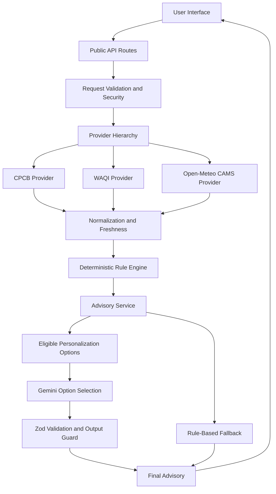

# 🌿 VayuSetu — Urban Air Quality & Winter Smog Assistant

<p align="center">
  <strong>Bridging the gap between environmental data and healthier everyday decisions.</strong>
</p>

<p align="center">
  <a href="https://vayusetu-eight.vercel.app">
    
  </a>
  
  
  
  
</p>

<p align="center">
  <a href="https://vayusetu-eight.vercel.app">🚀 Explore the Live Application</a>
  &nbsp; • &nbsp;
  <a href="https://github.com/AbdulWebAgency/VayuSetu">💻 Source Code</a>
</p>

**VayuSetu** is an AI-assisted urban air-quality companion designed to help Indian households make safer, more informed and sustainable everyday decisions during periods of air pollution and winter smog.

It combines environmental data from air-quality providers with deterministic safety rules and optional, evidence-constrained Google Gemini personalization to deliver practical recommendations based on location, household circumstances and available air-quality information.

🌐 **Live application:** https://vayusetu-eight.vercel.app
💻 **GitHub repository:** https://github.com/AbdulWebAgency/VayuSetu

---

## 🎯 Problem statement

Air pollution affects everyday decisions: when to commute, whether to exercise outdoors, how to ventilate a home and what precautions different household members may need.

However, raw AQI readings alone do not always explain what people should actually do.

VayuSetu aims to bridge that gap by translating environmental information into understandable, practical guidance for Indian households.

## 🌱 Three core pillars

### 1. Low-emission daily routines

Practical recommendations for adjusting daily activities based on environmental conditions, including commuting, outdoor activities and household routines.

### 2. Indoor air-quality guidance

Guidance on ventilation, reducing indoor pollution sources and interpreting user-reported indoor PM2.5 readings.

### 3. Sustainable alternatives and impact

Suggestions for more sustainable everyday choices, including alternatives that can help reduce individual and household contributions to pollution.

Recommendations are designed to explain their reasoning rather than simply present instructions.

---

## ✨ Key features

- **Location-aware air-quality information:** Supports Indian locations and uses available environmental data providers.
- **Household personalisation:** Considers household circumstances and the needs of different members.
- **Daily planning:** Organises practical recommendations across morning, afternoon and evening.
- **Indoor air-quality guidance:** Provides actionable suggestions without treating a single indoor PM2.5 reading as a complete indoor AQI measurement.
- **Evidence-constrained AI personalization:** Gemini selects from approved, household-specific personalization options without rewriting environmental facts or safety decisions.
- **Deterministic fallback:** Continues to provide rule-based guidance when AI services are unavailable.
- **Data provenance:** Displays relevant source, measurement timing and AQI scale information.
- **Safety checks:** Validates structured AI selections and rejects unsupported or ineligible personalization.

---

## 🛡️ Household Guidance Confidence

Understanding whether guidance is supported by current evidence is as important as receiving the guidance itself.

VayuSetu makes that distinction visible through four connected safeguards:

| Safeguard                     | Household benefit                                                                                                                |
| ----------------------------- | -------------------------------------------------------------------------------------------------------------------------------- |
| Outdoor evidence transparency | Explains whether current observations indicate elevated conditions, lower observed indicators or insufficient decision evidence. |
| Indoor measurement integrity  | Prevents old or untimed indoor readings from being presented as recent measurements.                                             |
| Profile synchronization       | Identifies recommendations generated for previous household inputs and provides an explicit update action.                       |
| Truthful AI contribution      | Distinguishes accepted, visible AI personalization from deterministic guidance.                                                  |

The outdoor evidence indicator uses the same classification logic as the deterministic rule engine, keeping recommendations and their explanations consistent.

When household inputs change, previous guidance is clearly identified until the user requests an update. Obsolete in-flight responses cannot overwrite refreshed guidance.

Indoor comparison feedback remains responsive to changes in the reported measurement.

Confidence here means transparency about evidence and its limitations, not a numerical confidence score, pollution forecast or guarantee of safe air.

---

## 🧠 Data integrity and safety

Environmental information must be trustworthy. VayuSetu therefore separates environmental data retrieval from AI-generated explanations.

### Environmental data

The application uses a provider hierarchy involving:

- CPCB data through the data.gov.in API, where configured and available.
- WAQI ground-station data, where configured and available.
- Open-Meteo CAMS model data as an alternative source.

Provider availability can vary. The application preserves the provenance of the selected data rather than combining readings from different providers into a fabricated measurement.

Providers returning no usable environmental values are skipped in favour of the next eligible provider. Partial observations retain their original attribution, but may provide insufficient evidence for particular household decisions.

The rule engine distinguishes elevated indicators, lower observed indicators and insufficient decision evidence. Elevated evidence takes precedence when indicators disagree. Lower observed indicators do not establish that outdoor air is safe.

Activity recommendations and daily planner decisions share the same environmental decision logic.

### Freshness classification

Freshness is calculated using the provider's `measuredAt` timestamp, not the time the application fetched the data.

| Data type      |         Live |                     Aging |        Stale |
| -------------- | -----------: | ------------------------: | -----------: |
| Ground station |  ≤90 minutes |           >90–180 minutes | >180 minutes |
| Model data     | ≤180 minutes | Not separately classified | >180 minutes |

Invalid and future measurement timestamps are treated as stale. Future observations remain ineligible until their reported measurement time arrives.

### Indoor air-quality safeguards

- Indoor PM2.5 values are user-reported.
- A single PM2.5 reading is not converted into an indoor AQI value.
- Indoor and outdoor readings are compared only when eligible measurement timestamps are within an inclusive 120-minute window, calculated before display rounding.
- A reported reading age is anchored to an absolute measurement timestamp. Missing timing information does not imply a fresh measurement.
- Indoor observations are session-only and clear on reload, while durable household preferences such as sensor ownership persist.
- Legacy saved indoor readings without reliable timing are discarded.
- Qualitative indoor guidance remains available even when a meaningful numerical comparison cannot be made.

### AI is an enrichment layer, not the source of truth

Gemini does not generate live AQI measurements or replace environmental data providers.

Instead, Gemini selects from a bounded set of eligible personalization options constructed from the household profile and deterministic advisory.

The model may prioritize an approved recommendation or select an approved explanatory addition. It cannot rewrite environmental measurements, safety decisions, recommendation membership or planner actions.

A strict Zod schema and output guard reject unexpected fields and discard ineligible selections. AI-enriched status is reported only when an accepted selection produces a visible change.

If personalization is unavailable, rejected or produces no visible change, the deterministic advisory remains available.

---

## 🏗️ Architecture

VayuSetu follows a separation-of-concerns architecture, keeping environmental data retrieval, domain logic, AI enrichment and presentation separate.



### Provider hierarchy

Environmental providers are handled through a dedicated provider hierarchy. The application normalizes incoming data into a common internal representation while retaining the original source and measurement metadata.

This avoids treating readings from different providers as interchangeable or silently merging incompatible measurements.

---

## 🧩 Project structure

The following are the principal application modules:

| Directory / File                | Responsibility                                                                  |
| ------------------------------- | ------------------------------------------------------------------------------- |
| `src/routes/`                   | Application pages and public API endpoints                                      |
| `src/components/dashboard/`     | Air-quality overview, household profile, daily planner and recommendations      |
| `src/components/common/`        | Shared components such as error boundaries and severity badges                  |
| `src/hooks/`                    | Application hooks, including household profile state                            |
| `src/lib/`                      | Public API client and shared utilities                                          |
| `src/domain/`                   | Freshness, normalization, indoor comparisons, rule engine and output validation |
| `src/server/providers/`         | Environmental data providers, geocoding and provider hierarchy                  |
| `src/server/gemini/`            | Gemini client and prompt construction                                           |
| `src/server/cache/`             | Best-effort per-instance fetch cache                                            |
| `src/server/security/`          | Request validation and rate-limiting logic                                      |
| `src/server/advisoryService.ts` | Advisory generation and AI fallback orchestration                               |
| `src/types/`                    | Shared TypeScript data types                                                    |
| `tests/`                        | Unit, integration, component, contract and security tests                       |

---

## 🔐 Security and reliability

Security and reliability are built into the server-side architecture.

- **Server-side secrets:** API keys are accessed through server-side environment variables and are not exposed through `VITE_` variables.
- **Request validation:** Public API requests are validated before processing.
- **Request-size protection:** Request bodies are subject to size limits.
- **Origin validation:** Same-origin requests are supported, with optional additional allowed origins.
- **Rate limiting:** Fixed-window, per-key rate limiting is implemented as a best-effort, per-instance mechanism.
- **AI response validation:** Gemini responses are checked against a Zod schema and output guardrails.
- **Provider resilience:** Provider failures and unavailable AI services are handled through fallback paths.
- **Timeout handling:** Gemini uses a shared 20-second execution deadline across requests, response-body reads, retries and fallback models, alongside existing per-attempt timeouts.

**Rate-limiting limitation:** The current limiter stores its counters in memory. It is not a distributed rate limiter, so limits are not globally shared across serverless instances.

---

## 🤖 Gemini integration

Gemini provides bounded household personalization while the deterministic rule engine remains responsible for environmental interpretation, safety decisions and practical guidance.

The integration includes:

- Configurable model selection through `GEMINI_MODEL`.
- A default model of `gemini-3.5-flash-lite` in the current client implementation.
- Fallback model handling.
- Per-attempt timeouts and retries within a shared 20-second execution deadline.
- Structured JSON selection of approved personalization options.
- Request-local eligibility checks for recommendation prioritization and explanatory additions.
- Preservation of deterministic actions, evidence and planner decisions.
- AI contribution reporting based on accepted, visible personalization.
- Zod schema validation.
- Output guardrails.
- Deterministic rule-based fallback when AI enrichment is unavailable.

The application is designed to remain useful without a configured Gemini API key.

---

## 🧪 Testing and verification

The project includes automated tests covering the application’s domain logic, security boundaries, provider contracts, advisory pipeline and user-interface components.

### Latest verified test results

| Test category    |     Result |
| ---------------- | ---------: |
| Test files       |  18 passed |
| Individual tests | 167 passed |
| Failed tests     |          0 |

**Command executed:**

```bash
npm test
```

**Result:** All 18 test files and all 167 tests passed.

The regression suite covers environmental evidence sufficiency, provider fallback, activity consistency, Gemini deadlines, constrained personalization, measurement lifetime, exact indoor comparison boundaries and obsolete advisory responses.

Both existing Playwright household journeys also passed against the development server after correcting API interception to avoid matching development JavaScript modules. The same journeys passed against a local production artifact before that test-harness correction.

These browser journeys use mocked API responses and do not establish live-provider availability.

Additional local verification:

- The production build succeeded and its generated Vercel function configuration was checked locally.
- Authored ESLint reported zero errors and zero warnings, with vendor UI primitives and the generated route tree excluded from that check.
- Full-checkout ESLint reported zero errors and six existing Fast Refresh warnings in vendor UI primitives.

---

## 🚀 Deployment

The following settings were verified in the local Vercel production build.

| Configuration             | Value           |
| ------------------------- | --------------- |
| Hosting                   | Vercel          |
| Runtime                   | Node.js 24.x    |
| Region                    | Mumbai (`bom1`) |
| Maximum function duration | 60 seconds      |
| Framework                 | TanStack Start  |
| Build tool                | Vite            |

The root `vercel.json` declares region `bom1` (Mumbai). The `npm run build` post-step writes that region and the 60-second maximum duration into the generated function configuration. These settings describe the local build output.

---

## 💻 Run locally

### Prerequisites

- Node.js 24.x recommended
- npm
- Bun for the default Playwright development-server workflow and live smoke tests
- A Google Gemini API key (optional)
- Optional provider API keys for additional environmental data sources

### 1. Clone the repository

```bash
git clone https://github.com/AbdulWebAgency/VayuSetu.git
cd VayuSetu
```

### 2. Install dependencies

```bash
npm install
```

### 3. Configure environment variables

Create a `.env` file in the project root.

```env
GEMINI_API_KEY=
GEMINI_MODEL=
WAQI_API_TOKEN=
DATA_GOV_IN_API_KEY=
ALLOWED_ORIGINS=
```

| Variable              | Purpose                                                     |
| --------------------- | ----------------------------------------------------------- |
| `GEMINI_API_KEY`      | Optional Google Gemini API key for AI-enriched guidance     |
| `GEMINI_MODEL`        | Optional Gemini model override                              |
| `WAQI_API_TOKEN`      | Optional WAQI ground-station data access                    |
| `DATA_GOV_IN_API_KEY` | Optional CPCB data access through data.gov.in               |
| `ALLOWED_ORIGINS`     | Optional comma-separated list of additional allowed origins |

All secrets must remain server-side. Do not prefix these variables with `VITE_`.

Without a Gemini API key, the application can still provide deterministic rule-based guidance.

### 4. Start the development server

```bash
npm run dev
```

### 5. Build for production

```bash
npm run build
```

### 6. Run automated tests

```bash
npm test
```

### Additional test commands

```bash
npm run test:watch
npm run test:e2e
npm run test:smoke
```

Local development uses `npm run dev`. The live smoke-test script requires Bun. By default, Playwright uses `bun run dev` to manage its development server and requires a compatible browser. Set `E2E_BASE_URL` to point Playwright at an already running server instead.

The development-server Playwright interception issue has been resolved. Both household journeys pass using the default development-server configuration.

To install the Playwright Chromium browser when needed:

```bash
npx playwright install chromium
```

Mocked Vitest and Playwright runs exercise the application with controlled test responses. Live smoke testing is a separate verification step.

---

## ⚖️ Limitations

VayuSetu is an informational and decision-support application, not a medical diagnostic system.

- Environmental data availability depends on external providers.
- Ground-station coverage and measurement frequency vary by location.
- Model-based estimates are not equivalent to direct ground-station measurements.
- Indoor measurements are user-reported and may not represent an entire home.
- Indoor observations clear on reload and must be entered again when needed.
- Provider clock discrepancies can temporarily make future-dated observations ineligible.
- Current observations do not establish future pollution conditions or guarantee safe outdoor activity.
- Gemini personalization is optional and limited to approved choices. Guidance should not replace official public-health advice.
- Rate limiting is per serverless instance rather than globally distributed.

Users should follow official health advisories during severe pollution events.

---

## 🛠️ Technology stack

| Area               | Technologies                        |
| ------------------ | ----------------------------------- |
| Frontend           | React 19, TypeScript                |
| Framework          | TanStack Start, TanStack Router     |
| Styling            | Tailwind CSS                        |
| UI components      | Radix UI, Lucide React              |
| Data fetching      | TanStack Query                      |
| Validation         | Zod                                 |
| AI integration     | Google Gemini                       |
| Environmental data | CPCB, WAQI, Open-Meteo CAMS         |
| Build tooling      | Vite                                |
| Hosting            | Vercel                              |
| Testing            | Vitest, Testing Library, Playwright |

---

## 🌍 Our philosophy

Air-quality information should be more than a number on a screen.

It should help people understand their environment, make practical everyday decisions and adopt more sustainable habits.

VayuSetu brings together environmental data, deterministic safety rules and AI-assisted explanations to make that information more useful for Indian households.

**VayuSetu — Better air awareness. Smarter everyday choices.** 🌱

---

<p align="center">
  <strong>🌍 Better Awareness. Smarter Decisions. More Sustainable Living.</strong>
</p>

<p align="center">
  <a href="https://vayusetu-eight.vercel.app">Visit VayuSetu</a>
  &nbsp; • &nbsp;
  <a href="https://github.com/AbdulWebAgency/VayuSetu">Explore the Repository</a>
</p>

<p align="center">
  <em>Built for PromptWars Virtual Challenge 06.</em>
</p>
