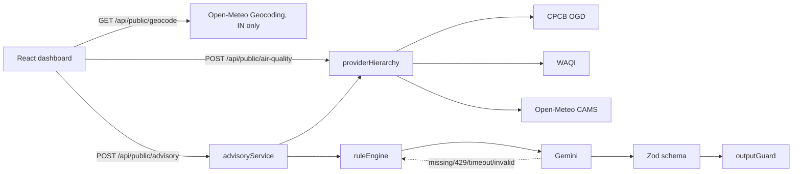

# VayuSetu — Urban Air Quality & Winter Smog Assistant

VayuSetu turns **verified outdoor air-quality data** and a household's circumstances into practical daily decisions for **Indian urban households** (Hyderabad, Delhi, Mumbai, Kolkata, Bengaluru, Chennai, plus confirmed custom Indian locations) during winter smog.

## Design philosophy & boundaries
**Does:** show provider-supplied readings with full provenance; give 3-pillar recommendations (low-emission routines, indoor air, sustainable alternatives) and a Morning/Afternoon/Evening plan.
**Does not:** invent or simulate AQI/PM values, derive AQI from concentrations, compute an indoor AQI, present outdoor data as indoor, merge providers, diagnose or promise health outcomes, or claim percentage reductions. It is not a chatbot.

## Architecture

**Platform note:** the spec asked for Vercel functions (`api/*.ts`). This project runs on TanStack Start (edge Workers), so the same three endpoints are server routes at `src/routes/api/public/{geocode,air-quality,advisory}.ts`, and server-only modules live in `src/server/` (blocked from client bundles).

| Path | Responsibility |
|---|---|
| `src/types/airQuality.ts` | Zod schemas + inferred types (incl. `AiAdvisoryResponseSchema`) |
| `src/domain/` | `catalogues`, `normalizer`, `freshness`, `indoorComparison`, `ruleEngine`, `outputGuard`, `domainErrors` |
| `src/server/providers/` | `cpcbProvider`, `waqiProvider`, `openMeteoProvider`, `geocodingProvider`, `providerHierarchy`, `http` (timeouts/retry) |
| `src/server/gemini/` | `geminiClient`, `promptBuilder` |
| `src/server/security/` | `requestGuard` (CORS, 16 KB limit → 413, Zod), `rateLimiter` (→ 429) |
| `src/server/cache/fetchCache.ts` | best-effort per-instance cache |
| `src/components/` | `common/` (ErrorBoundary, SeverityBadge), `dashboard/` (ScenarioSwitcher, LocationSelector, HouseholdProfileForm, AirQualityOverview, RecommendationCards, DailyPlanner) |

## Provider hierarchy
1. **CPCB** (if `DATA_GOV_IN_API_KEY`) — nearest station ≤ 25 km, concentrations only (AQI shown as *Unavailable*).
2. **WAQI** (if `WAQI_API_TOKEN`) — station ≤ 25 km, US EPA AQI. WAQI publishes sub-indices, not µg/m³, so concentrations are shown as not supplied.
3. **Open-Meteo CAMS** (no key) — labelled *Atmospheric Model Estimate (Open-Meteo / CAMS Global)*, US EPA AQI supplied by the provider.
4. All fail → **Live Environmental Data Unavailable** banner + general precautionary guidance.

Ground stations and model estimates are used only when not stale. Providers are never merged. CPCB retains only valid, nonfuture rows at most 3 hours old, within 90 minutes of the newest usable pollutant row, and labels the station with the oldest retained measurement timestamp.

## Freshness, caching & retention
- Ground station: Live ≤ 90 min, Aging ≤ 3 h, Stale > 3 h. Model: Live ≤ 3 h, Stale > 3 h. Always from `measuredAt`, never `fetchedAt`.
- In-memory cache (Open-Meteo/CPCB ≤ 10 min, geocoding 24 h) is per-instance and optional; correctness never depends on it. **WAQI is never cached.**
- Timeouts: 6 s per provider attempt, with an overall **12 s provider waterfall deadline** covering retries and JSON response consumption. Providers after exhaustion are skipped. Gemini has a separate 10 s per-attempt timeout and one retry (up to 20 s); the full advisory can therefore take approximately 32 s plus processing. No retry on 4xx/429.
- Rate limits (per instance): 30 req/min standard, 6 req/min advisory. On advisory 429 the client fetches data only and runs the rule engine locally.

## Indoor measurement integrity
Indoor values appear only as **User-Reported Indoor PM2.5 (µg/m³)**. No indoor AQI. A numeric indoor/outdoor comparison appears only when both exist and the timestamps are within 2 h; otherwise the UI says they are not comparable. Without a sensor, *General Indoor Air-Quality Guidance* is shown.

## AI layer
Gemini (`gemini-2.5-flash`) receives a separate system instruction and escaped XML data blocks (`<household_profile>`, `<verified_environment>`, `<rule_baseline>`). Output is validated with Zod, then `outputGuard` rejects purifier-dependent advice (when none owned), indoor-AQI claims, percentage claims, medical claims and links, and back-fills missing pillars/slots from the rule engine. All accepted AI recommendation basis labels are overwritten from fresh verified provenance: CPCB/WAQI ground observations → Measured, Open-Meteo model → Estimated, no fresh source → Qualitative. Numeric environmental sentences must match verified values for the named pollutant; indoor PM2.5 requires the household's reported sensor value. Ambiguous multi-pollutant numerical sentences are rejected conservatively. Planner slots receive the same safety and numerical checks. UI shows *AI-Enriched* vs *Rule-Based Guidance Active*.

## Request security and deployment
Bodies are stream-counted and cancelled above 16,384 bytes, independently of declared Content-Length. Origin authorization uses the request URL's exact origin or an exact entry in `ALLOWED_ORIGINS`; neither Host nor X-Forwarded-Host authorizes a caller. At deployment, explicitly list trusted canonical frontend origins if the hosting proxy exposes a different internal request URL. CORS is not authentication; these endpoints remain intentionally public, and rate limits are per instance.

`vite.config.ts` currently selects Nitro's `vercel` preset. A Vercel deployment still needs an actual build/deploy smoke check, server-only environment variables, outbound access to providers/Google, and a function execution limit above the approximately 32-second worst-case advisory duration. This hardening pass does not deploy or verify Vercel. Lovable's hosted runtime remains separate from Vercel. Never expose secrets via `VITE_*`; use `GEMINI_API_KEY` (required only for real AI), with optional `DATA_GOV_IN_API_KEY`, `WAQI_API_TOKEN`, and `ALLOWED_ORIGINS`.

## Sample scenarios
A — Family with young children, Hyderabad · B — Working commuter (car, morning exercise), Delhi · C — Elderly member with respiratory sensitivity, no purifier, Mumbai · D — Student household on public transit, Kolkata.

## Testing
| Command | Scope |
|---|---|
| `bun run test` | Vitest: `tests/unit` (incl. `contrast.test.ts` measuring WCAG AA on real CSS tokens), `tests/contracts`, `tests/integration`, `tests/components`, `tests/security` — no network |
| `bun run test:e2e` | Playwright browser journey against mocked API routes (`PLAYWRIGHT_CHROMIUM_PATH` optional) |
| `bun run test:smoke` | Optional live Open-Meteo checks |

## Accessibility
Landmarks, labelled inputs, visible focus rings, `aria-live` status, severity shown as icon + text + number, AA contrast verified by test.

## Setup
`bun install && bun run dev`. Copy `.env.example`; all variables are optional server secrets.

## Known limitations
- Rate limiting and caching are per-instance (no shared store).
- CPCB lookup filters by city name, so small towns may fall back to the model.
- Model estimates are grid-level and can differ from street-level conditions.
